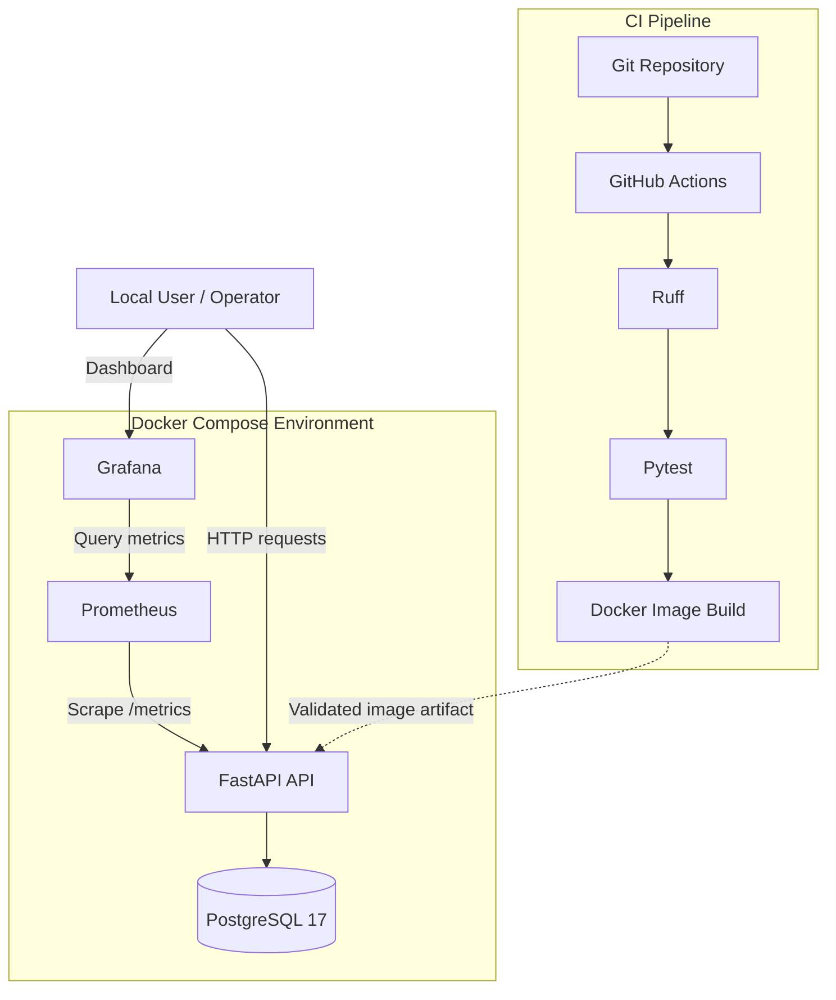

# Apex Operations API — System Architecture

## 1. Overview

The Apex Operations API is a containerized FastAPI service running alongside PostgreSQL, Prometheus, and Grafana through Docker Compose.

The architecture demonstrates application deployment, dependency management, monitoring, CI validation, and release recovery.

## 2. High-Level Architecture

## 3. Application Components
### FastAPI
Responsibilities:
- Serve application HTTP requests.
- Expose liveness and readiness endpoints.
- Connect to PostgreSQL.
- Generate Prometheus metrics.
- Write application logs to standard output.
Endpoints:
- / — service information and version.
- /health — application liveness.
- /ready — database readiness.
- /metrics — Prometheus metrics.
### PostgreSQL
Responsibilities:
- Provide relational database storage.
- Persist data using a Docker named volume.
- Expose database health through pg_isready.
### Prometheus
Responsibilities:
- Scrape API metrics every 15 seconds.
- Evaluate configured alert rules.
- Store time-series monitoring data in a persistent volume.
### Grafana
Responsibilities:
- Visualize Prometheus metrics.
- Display service availability, request rate, errors, and latency.
- Support operational investigation through dashboards and alerting.
## 4. Container Architecture
The API image uses Python 3.12 slim.

Container security characteristics:
- Dedicated system user.
- Non-root application execution.
- Application dependencies installed during image build.
- Uvicorn listens on port 8000 inside the container.
Docker Compose connects services using internal service DNS names.

The API connects to PostgreSQL through the db service name. Prometheus scrapes the API through api:8000.
## 5. Request Flow
1. A client sends an HTTP request to the API.
2. FastAPI processes the request.
3. The request middleware records request count and duration.
4. HTTP error responses increment the error counter.
5. The API communicates with PostgreSQL when required.
6. The response is returned to the client.
7. Prometheus periodically collects metrics.
8. Grafana queries Prometheus to visualize service behavior.
## 6. CI Flow
The GitHub Actions workflow is configured for pushes and pull requests targeting main.

Pipeline sequence:
1. Checkout repository.
2. Set up Python 3.12.
3. Install development dependencies.
4. Audit application dependencies using pip-audit.
5. Execute Ruff lint checks.
6. Run Pytest.
7. Build the Docker image.
8. Scan the image using Trivy for HIGH and CRITICAL vulnerabilities.

Linting, tests, and dependency auditing must pass before the image build step executes. The Trivy scan runs after the image is built.
## 7. Release and Rollback Flow
### Release
1. Operator requests a new semantic version.
2. Release script builds the new image.
3. A temporary container starts.
4. The temporary container health endpoint is validated.
5. The current version is recorded as the previous version.
6. The new image is deployed through Docker Compose.
7. Container health is verified.
8. Failed deployment validation triggers restoration of the previous version.
### Rollback
1. Read current and previous application versions.
2. Confirm the previous image exists locally.
3. Update the configured application version.
4. Deploy the previous image.
5. Wait for container health.
6. Restore the original version if rollback validation fails.
## 8. Network and Port Mapping

The current compose.yaml configures:

| Service | Internal port | Host port |
|---|---:|---:|
| API | 8000 | 8002 |
| PostgreSQL | 5432 | Internal only |
| Prometheus | 9090 | 9091 |
| Grafana | 3000 | 3001 |

Host ports are bound to 127.0.0.1 to restrict access to the local machine.
## 9. Persistent Storage
Named Docker volumes:
- postgres_data — PostgreSQL data.
- prometheus_data — Prometheus time-series data.
- grafana_data — Grafana configuration and dashboard data.
These volumes are independent of the lifecycle of individual containers.

Routine service shutdown should not remove persistent volumes.
## 10. Security Boundaries
- Application container executes as a non-root user.
- Credentials are supplied through environment variables.
- .env must remain outside source control.
- Prometheus configuration is mounted read-only.
- Grafana self-registration is disabled.
- Host-facing ports are bound to localhost.
- CI audits application dependencies using pip-audit.
- CI scans the built Docker image using Trivy for HIGH and CRITICAL vulnerabilities.

Additional production controls would include TLS, centralized secret management, image vulnerability scanning, and authenticated monitoring access.
## 11. Architecture Limitations
This is a single-machine local assessment architecture.

It does not provide:
- Multi-node high availability.
- Automatic horizontal scaling.
- Managed database failover.
- Distributed tracing.
- Centralized log aggregation.
- Remote container image storage.
- Production-grade secret management.
These capabilities would be evaluated separately for a production deployment.
